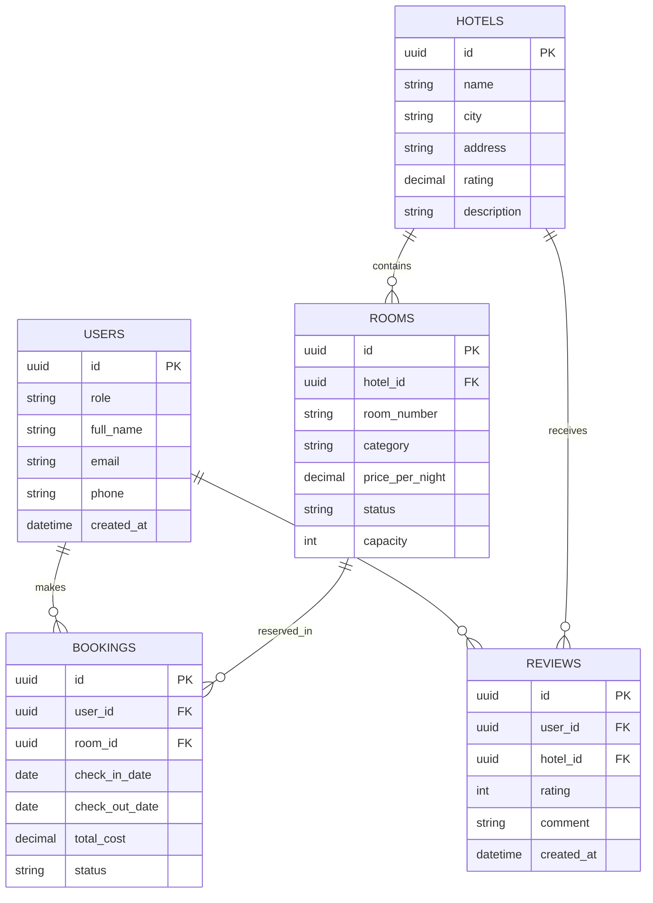
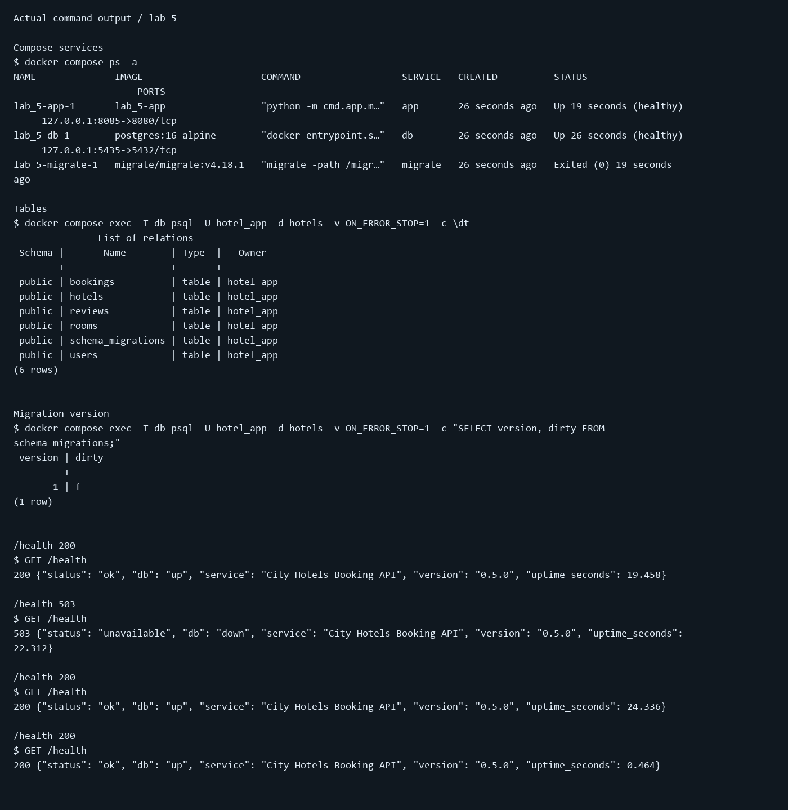
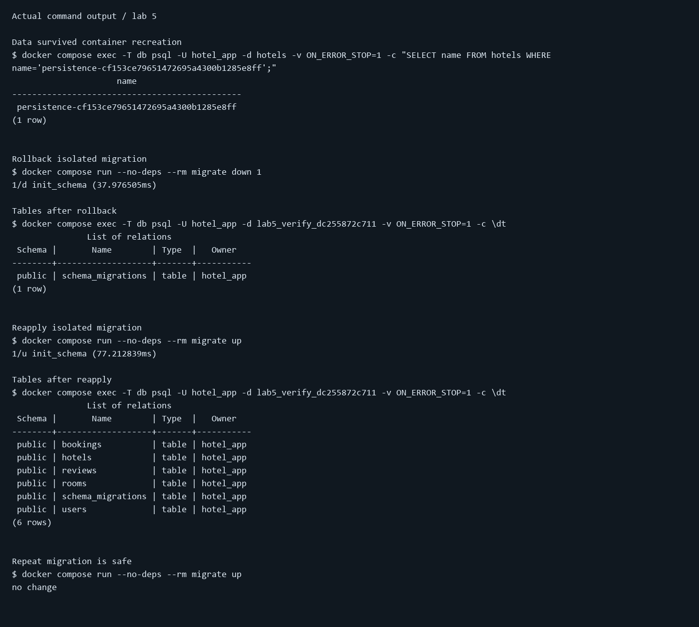

# Отчёт по лабораторной работе №5

Дисциплина: «Разработка серверных приложений»

Тема работы: PostgreSQL, миграции и Docker Compose

Предметная область: бронирование номеров в городских отелях.

Выполнил: ____________________  Группа: __________

Проверил: ____________________  Учебное заведение: ____________________

Дата выполнения: 28.10.2026

## Цель

Подключить сервер к PostgreSQL, описать схему миграцией, организовать запуск Compose и проверить отказоустойчивость и сохранность данных.

## Реализация

### erd.mmd



### migrations/000001_init_schema.up.sql

```sql
BEGIN;
CREATE TABLE users (
    id UUID PRIMARY KEY DEFAULT gen_random_uuid(),
    role VARCHAR(20) NOT NULL DEFAULT 'GUEST' CHECK (role IN ('GUEST', 'MANAGER')),
    full_name VARCHAR(200) NOT NULL CHECK (btrim(full_name) <> ''),
    email VARCHAR(255) NOT NULL UNIQUE,
    phone VARCHAR(30),
    password_hash TEXT NOT NULL,
    created_at TIMESTAMPTZ NOT NULL DEFAULT now()
);
CREATE TABLE hotels (
    id UUID PRIMARY KEY DEFAULT gen_random_uuid(),
    name VARCHAR(200) NOT NULL CHECK (btrim(name) <> ''),
    city VARCHAR(100) NOT NULL CHECK (btrim(city) <> ''),
    address VARCHAR(300) NOT NULL CHECK (btrim(address) <> ''),
    rating NUMERIC(3,2) NOT NULL DEFAULT 0 CHECK (rating BETWEEN 0 AND 5),
    description TEXT NOT NULL DEFAULT '',
    created_at TIMESTAMPTZ NOT NULL DEFAULT now(),
    UNIQUE (city, address, name)
);
CREATE TABLE rooms (
    id UUID PRIMARY KEY DEFAULT gen_random_uuid(),
    hotel_id UUID NOT NULL REFERENCES hotels(id) ON DELETE RESTRICT,
    room_number VARCHAR(20) NOT NULL CHECK (btrim(room_number) <> ''),
    category VARCHAR(20) NOT NULL CHECK (category IN ('STANDARD', 'LUXE', 'SUITE')),
    price_per_night NUMERIC(12,2) NOT NULL CHECK (price_per_night >= 0),
    status VARCHAR(20) NOT NULL DEFAULT 'AVAILABLE'
        CHECK (status IN ('AVAILABLE', 'OCCUPIED', 'MAINTENANCE')),
    capacity INT NOT NULL CHECK (capacity > 0),
    created_at TIMESTAMPTZ NOT NULL DEFAULT now(),
    UNIQUE (hotel_id, room_number)
);
CREATE TABLE bookings (
    id UUID PRIMARY KEY DEFAULT gen_random_uuid(),
    user_id UUID NOT NULL REFERENCES users(id) ON DELETE RESTRICT,
    room_id UUID NOT NULL REFERENCES rooms(id) ON DELETE RESTRICT,
    check_in_date DATE NOT NULL,
    check_out_date DATE NOT NULL,
    total_cost NUMERIC(12,2) NOT NULL CHECK (total_cost >= 0),
    status VARCHAR(20) NOT NULL DEFAULT 'CONFIRMED'
        CHECK (status IN ('PENDING', 'CONFIRMED', 'CANCELED')),
    created_at TIMESTAMPTZ NOT NULL DEFAULT now(),
    CONSTRAINT chk_booking_period CHECK (check_out_date > check_in_date)
);
CREATE TABLE reviews (
    id UUID PRIMARY KEY DEFAULT gen_random_uuid(),
    user_id UUID NOT NULL REFERENCES users(id) ON DELETE CASCADE,
    hotel_id UUID NOT NULL REFERENCES hotels(id) ON DELETE CASCADE,
    rating INT NOT NULL CHECK (rating BETWEEN 1 AND 5),
    comment TEXT NOT NULL DEFAULT '',
    created_at TIMESTAMPTZ NOT NULL DEFAULT now(),
    UNIQUE (user_id, hotel_id)
);
-- UNIQUE (hotel_id, room_number) already indexes the rooms.hotel_id FK.
-- UNIQUE (user_id, hotel_id) already indexes the reviews.user_id FK.
CREATE INDEX idx_bookings_user_id ON bookings(user_id);
CREATE INDEX idx_bookings_room_period ON bookings(room_id, check_in_date, check_out_date);
CREATE INDEX idx_reviews_hotel_id ON reviews(hotel_id);
COMMIT;

```

### migrations/000001_init_schema.down.sql

```sql
BEGIN;
DROP TABLE reviews;
DROP TABLE bookings;
DROP TABLE rooms;
DROP TABLE hotels;
DROP TABLE users;
COMMIT;

```

### docker-compose.yml

```yaml
services:
  db:
    image: postgres:16-alpine
    restart: unless-stopped
    environment:
      POSTGRES_USER: ${DB_USER:?Set DB_USER in .env}
      POSTGRES_PASSWORD: ${DB_PASSWORD:?Set DB_PASSWORD in .env}
      POSTGRES_DB: ${DB_NAME:?Set DB_NAME in .env}
    ports:
      - "127.0.0.1:${DB_HOST_PORT:-5435}:5432"
    volumes:
      - pgdata:/var/lib/postgresql/data
    healthcheck:
      test: ["CMD-SHELL", "pg_isready -U $$POSTGRES_USER -d $$POSTGRES_DB"]
      interval: 3s
      timeout: 3s
      retries: 15
      start_period: 10s
  migrate:
    image: migrate/migrate:v4.18.1
    volumes:
      - ./migrations:/migrations:ro
    entrypoint:
      - migrate
      - -path=/migrations
      - -database=postgres://${DB_USER}:${DB_PASSWORD}@db:5432/${DB_NAME}?sslmode=disable
    command: ["up"]
    depends_on:
      db:
        condition: service_healthy
    restart: "no"
  app:
    build: .
    restart: unless-stopped
    ports:
      - "127.0.0.1:${HTTP_PORT:-8085}:8080"
    environment:
      APP_HOST: 0.0.0.0
      APP_PORT: 8080
      APP_VERSION: 0.5.0
      DB_HOST: db
      DB_PORT: 5432
      DB_USER: ${DB_USER}
      DB_PASSWORD: ${DB_PASSWORD}
      DB_NAME: ${DB_NAME}
      DB_MAX_CONNS: ${DB_MAX_CONNS:-10}
    depends_on:
      db:
        condition: service_healthy
      migrate:
        condition: service_completed_successfully
volumes:
  pgdata:

```

## Результаты проверки

Ниже визуальные копии сохранённого вывода реально выполненных команд. Это рендер журнала, а не снимки окна терминала. Полный вывод и коды завершения приведены далее и сохранены в JSON.




### Полный журнал

#### Compose services

```text
$ docker compose ps -a
NAME              IMAGE                     COMMAND                  SERVICE   CREATED          STATUS                      PORTS
lab_5-app-1       lab_5-app                 "python -m cmd.app.m…"   app       26 seconds ago   Up 19 seconds (healthy)     127.0.0.1:8085->8080/tcp
lab_5-db-1        postgres:16-alpine        "docker-entrypoint.s…"   db        26 seconds ago   Up 26 seconds (healthy)     127.0.0.1:5435->5432/tcp
lab_5-migrate-1   migrate/migrate:v4.18.1   "migrate -path=/migr…"   migrate   26 seconds ago   Exited (0) 19 seconds ago
Exit code: 0
```

#### Migration log

```text
$ docker compose logs --no-color migrate
migrate-1  | no change
Exit code: 0
```

#### Tables

```text
$ docker compose exec -T db psql -U hotel_app -d hotels -v ON_ERROR_STOP=1 -c \dt
               List of relations
 Schema |       Name        | Type  |   Owner   
--------+-------------------+-------+-----------
 public | bookings          | table | hotel_app
 public | hotels            | table | hotel_app
 public | reviews           | table | hotel_app
 public | rooms             | table | hotel_app
 public | schema_migrations | table | hotel_app
 public | users             | table | hotel_app
(6 rows)
Exit code: 0
```

#### Migration version

```text
$ docker compose exec -T db psql -U hotel_app -d hotels -v ON_ERROR_STOP=1 -c "SELECT version, dirty FROM schema_migrations;"
 version | dirty 
---------+-------
       1 | f
(1 row)
Exit code: 0
```

#### /health 200

```text
$ GET /health
200 {"status": "ok", "db": "up", "service": "City Hotels Booking API", "version": "0.5.0", "uptime_seconds": 19.458}
Exit code: 0
```

#### Stop database

```text
$ docker compose stop db
 Container lab_5-db-1  Stopping
 Container lab_5-db-1  Stopped
Exit code: 0
```

#### /health 503

```text
$ GET /health
503 {"status": "unavailable", "db": "down", "service": "City Hotels Booking API", "version": "0.5.0", "uptime_seconds": 22.312}
Exit code: 0
```

#### Start database

```text
$ docker compose start db
 Container lab_5-db-1  Starting
 Container lab_5-db-1  Started
Exit code: 0
```

#### /health 200

```text
$ GET /health
200 {"status": "ok", "db": "up", "service": "City Hotels Booking API", "version": "0.5.0", "uptime_seconds": 24.336}
Exit code: 0
```

#### Insert persistence marker

```text
$ docker compose exec -T db psql -U hotel_app -d hotels -v ON_ERROR_STOP=1 -c "INSERT INTO hotels(name,city,address) VALUES ('persistence-cf153ce79651472695a4300b1285e8ff','Test City','Test Street');"
INSERT 0 1
Exit code: 0
```

#### Remove containers, keep volume

```text
$ docker compose down
 Container lab_5-app-1  Stopping
 Container lab_5-app-1  Stopped
 Container lab_5-app-1  Removing
 Container lab_5-app-1  Removed
 Container lab_5-migrate-1  Stopping
 Container lab_5-migrate-1  Stopped
 Container lab_5-migrate-1  Removing
 Container lab_5-migrate-1  Removed
 Container lab_5-db-1  Stopping
 Container lab_5-db-1  Stopped
 Container lab_5-db-1  Removing
 Container lab_5-db-1  Removed
 Network lab_5_default  Removing
 Network lab_5_default  Removed
Exit code: 0
```

#### Recreate containers

```text
$ docker compose up -d
 Network lab_5_default  Creating
 Network lab_5_default  Created
 Container lab_5-db-1  Creating
 Container lab_5-db-1  Created
 Container lab_5-migrate-1  Creating
 Container lab_5-migrate-1  Created
 Container lab_5-app-1  Creating
 Container lab_5-app-1  Created
 Container lab_5-db-1  Starting
 Container lab_5-db-1  Started
 Container lab_5-db-1  Waiting
 Container lab_5-db-1  Healthy
 Container lab_5-migrate-1  Starting
 Container lab_5-migrate-1  Started
 Container lab_5-db-1  Waiting
 Container lab_5-migrate-1  Waiting
 Container lab_5-db-1  Healthy
 Container lab_5-migrate-1  Exited
 Container lab_5-app-1  Starting
 Container lab_5-app-1  Started
Exit code: 0
```

#### /health 200

```text
$ GET /health
200 {"status": "ok", "db": "up", "service": "City Hotels Booking API", "version": "0.5.0", "uptime_seconds": 0.464}
Exit code: 0
```

#### Data survived container recreation

```text
$ docker compose exec -T db psql -U hotel_app -d hotels -v ON_ERROR_STOP=1 -c "SELECT name FROM hotels WHERE name='persistence-cf153ce79651472695a4300b1285e8ff';"
                     name                     
----------------------------------------------
 persistence-cf153ce79651472695a4300b1285e8ff
(1 row)
Exit code: 0
```

#### Remove own persistence marker

```text
$ docker compose exec -T db psql -U hotel_app -d hotels -v ON_ERROR_STOP=1 -c "DELETE FROM hotels WHERE name='persistence-cf153ce79651472695a4300b1285e8ff';"
DELETE 1
Exit code: 0
```

#### Create isolated verification database

```text
$ docker compose exec -T db psql -U hotel_app -d hotels -v ON_ERROR_STOP=1 -c "CREATE DATABASE lab5_verify_dc255872c711;"
CREATE DATABASE
Exit code: 0
```

#### Apply isolated migration

```text
$ docker compose run --no-deps --rm migrate up
1/u init_schema (86.291278ms)
Exit code: 0
```

#### Isolated tables before rollback

```text
$ docker compose exec -T db psql -U hotel_app -d lab5_verify_dc255872c711 -v ON_ERROR_STOP=1 -c \dt
               List of relations
 Schema |       Name        | Type  |   Owner   
--------+-------------------+-------+-----------
 public | bookings          | table | hotel_app
 public | hotels            | table | hotel_app
 public | reviews           | table | hotel_app
 public | rooms             | table | hotel_app
 public | schema_migrations | table | hotel_app
 public | users             | table | hotel_app
(6 rows)
Exit code: 0
```

#### Seed isolated hotel

```text
$ docker compose exec -T db psql -U hotel_app -d lab5_verify_dc255872c711 -v ON_ERROR_STOP=1 -c "INSERT INTO hotels(id,name,city,address) VALUES ('00000000-0000-0000-0000-000000000001','Test Hotel','Test City','Street');"
INSERT 0 1
Exit code: 0
```

#### Valid room

```text
$ docker compose exec -T db psql -U hotel_app -d lab5_verify_dc255872c711 -v ON_ERROR_STOP=1 -c "INSERT INTO rooms(hotel_id,room_number,category,price_per_night,capacity) VALUES ('00000000-0000-0000-0000-000000000001','101','STANDARD',3000.50,2);"
INSERT 0 1
Exit code: 0
```

#### Negative price rejected (CHECK)

```text
$ docker compose exec -T db psql -U hotel_app -d lab5_verify_dc255872c711 -v ON_ERROR_STOP=1 -c "INSERT INTO rooms(hotel_id,room_number,category,price_per_night,capacity) VALUES ('00000000-0000-0000-0000-000000000001','102','STANDARD',-1,2);"
ERROR:  new row for relation "rooms" violates check constraint "rooms_price_per_night_check"
DETAIL:  Failing row contains (2649d158-e4b1-4045-86d5-989bfda6e390, 00000000-0000-0000-0000-000000000001, 102, STANDARD, -1.00, AVAILABLE, 2, 2026-10-27 21:48:36.62399+00).
Exit code: 1
```

#### Missing hotel rejected (FK)

```text
$ docker compose exec -T db psql -U hotel_app -d lab5_verify_dc255872c711 -v ON_ERROR_STOP=1 -c "INSERT INTO rooms(hotel_id,room_number,category,price_per_night,capacity) VALUES ('00000000-0000-0000-0000-000000000002','102','STANDARD',1,2);"
ERROR:  insert or update on table "rooms" violates foreign key constraint "rooms_hotel_id_fkey"
DETAIL:  Key (hotel_id)=(00000000-0000-0000-0000-000000000002) is not present in table "hotels".
Exit code: 1
```

#### Duplicate room rejected (UNIQUE)

```text
$ docker compose exec -T db psql -U hotel_app -d lab5_verify_dc255872c711 -v ON_ERROR_STOP=1 -c "INSERT INTO rooms(hotel_id,room_number,category,price_per_night,capacity) VALUES ('00000000-0000-0000-0000-000000000001','101','STANDARD',1,2);"
ERROR:  duplicate key value violates unique constraint "rooms_hotel_id_room_number_key"
DETAIL:  Key (hotel_id, room_number)=(00000000-0000-0000-0000-000000000001, 101) already exists.
Exit code: 1
```

#### Rollback isolated migration

```text
$ docker compose run --no-deps --rm migrate down 1
1/d init_schema (37.976505ms)
Exit code: 0
```

#### Tables after rollback

```text
$ docker compose exec -T db psql -U hotel_app -d lab5_verify_dc255872c711 -v ON_ERROR_STOP=1 -c \dt
               List of relations
 Schema |       Name        | Type  |   Owner   
--------+-------------------+-------+-----------
 public | schema_migrations | table | hotel_app
(1 row)
Exit code: 0
```

#### Reapply isolated migration

```text
$ docker compose run --no-deps --rm migrate up
1/u init_schema (77.212839ms)
Exit code: 0
```

#### Tables after reapply

```text
$ docker compose exec -T db psql -U hotel_app -d lab5_verify_dc255872c711 -v ON_ERROR_STOP=1 -c \dt
               List of relations
 Schema |       Name        | Type  |   Owner   
--------+-------------------+-------+-----------
 public | bookings          | table | hotel_app
 public | hotels            | table | hotel_app
 public | reviews           | table | hotel_app
 public | rooms             | table | hotel_app
 public | schema_migrations | table | hotel_app
 public | users             | table | hotel_app
(6 rows)
Exit code: 0
```

#### Repeat migration is safe

```text
$ docker compose run --no-deps --rm migrate up
no change
Exit code: 0
```

#### Missing configuration rejected

```text
$ docker compose run --no-deps --rm -e DB_PASSWORD= app python -m cmd.app.main
2026-10-27 21:48:41,634 ERROR Startup: Required environment variable DB_PASSWORD is not set
Exit code: 1
```

#### Startup retries

```text
$ docker compose run --no-deps --rm app python -c "from dataclasses import replace; from internal.config.settings import Settings; from internal.database.postgres import connect; connect(replace(Settings.from_environment(),db_host='127.0.0.1',db_port=1),attempts=2)"
error connecting in 'pool-1': connection failed: connection to server at "127.0.0.1", port 1 failed: Connection refused
	Is the server running on that host and accepting TCP/IP connections?
error connecting in 'pool-1': connection failed: connection to server at "127.0.0.1", port 1 failed: Connection refused
	Is the server running on that host and accepting TCP/IP connections?
Database connection attempt 1/2 failed
error connecting in 'pool-2': connection failed: connection to server at "127.0.0.1", port 1 failed: Connection refused
	Is the server running on that host and accepting TCP/IP connections?
error connecting in 'pool-2': connection failed: connection to server at "127.0.0.1", port 1 failed: Connection refused
	Is the server running on that host and accepting TCP/IP connections?
error connecting in 'pool-2': connection failed: connection to server at "127.0.0.1", port 1 failed: Connection refused
	Is the server running on that host and accepting TCP/IP connections?
Database connection attempt 2/2 failed
Traceback (most recent call last):
  File "<string>", line 1, in <module>
  File "/app/internal/database/postgres.py", line 40, in connect
    raise RuntimeError(f"Database unavailable after {attempts} attempts")
RuntimeError: Database unavailable after 2 attempts
Exit code: 1
```

#### Final service status

```text
$ docker compose ps -a
NAME              IMAGE                     COMMAND                  SERVICE   CREATED          STATUS                      PORTS
lab_5-app-1       lab_5-app                 "python -m cmd.app.m…"   app       25 seconds ago   Up 18 seconds (healthy)     127.0.0.1:8085->8080/tcp
lab_5-db-1        postgres:16-alpine        "docker-entrypoint.s…"   db        25 seconds ago   Up 24 seconds (healthy)     127.0.0.1:5435->5432/tcp
lab_5-migrate-1   migrate/migrate:v4.18.1   "migrate -path=/migr…"   migrate   25 seconds ago   Exited (0) 18 seconds ago
Exit code: 0
```

#### Restore database after verification

```text
$ docker compose start db

Exit code: 0
```

#### Remove only the temporary verification database

```text
$ docker compose exec -T db psql -U hotel_app -d hotels -v ON_ERROR_STOP=1 -c "DROP DATABASE lab5_verify_dc255872c711;"
DROP DATABASE
Exit code: 0
```

## Ответы на контрольные вопросы


1. **Зачем down и почему откат опасен?** Down отменяет изменение схемы. DROP удаляет
   данные, поэтому повторный up их не возвращает; в production часто нужна новая
   исправляющая миграция.
2. **Почему нельзя менять применённую миграцию?** Разные базы получат разную схему
   с одним номером. Инструмент хранит применённую версию в schema_migrations;
   новые изменения оформляются новым файлом.
3. **Почему недостаточно depends_on?** Запуск контейнера не равен готовности базы.
   Healthcheck проверяет готовность. Повторные подключения нужны и при последующих сбоях.
4. **Зачем pgdata?** Том сохраняет данные независимо от контейнера. down сохраняет,
   down -v удаляет том и данные.
5. **localhost или db?** В Compose приложение использует db:5432. При запуске Python
   на компьютере — 127.0.0.1 и опубликованный порт 5435.
6. **Что такое пул и зачем ограничение?** Набор повторно используемых соединений.
   Сумма размеров пулов всех экземпляров должна быть меньше max_connections PostgreSQL
   с запасом для мигратора и администратора.
7. **Почему пароль не в коде?** Код и Git-история доступны другим людям. Настоящий
   пароль находится в исключённом .env; .env.example содержит только шаблон.
8. **Индексы FK и ON DELETE?** PostgreSQL не создаёт индекс дочернего FK автоматически.
   Индекс ускоряет поиск связей. CASCADE удаляет зависимые записи, RESTRICT запрещает
   удаление родителя, SET NULL оставляет дочернюю запись без связи, если поле допускает NULL.


## Выводы

Созданы пять связанных таблиц с ограничениями. Окружение воспроизводимо запускается, данные переживают пересоздание контейнеров. Проверены миграции up/down/up и HTTP 200/503/200.
