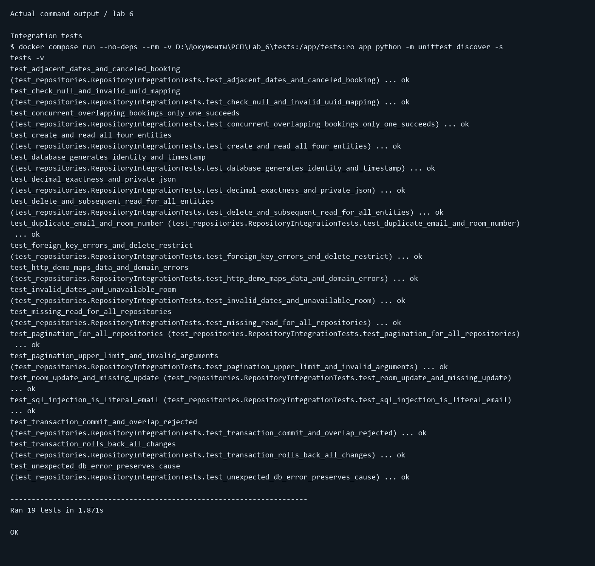
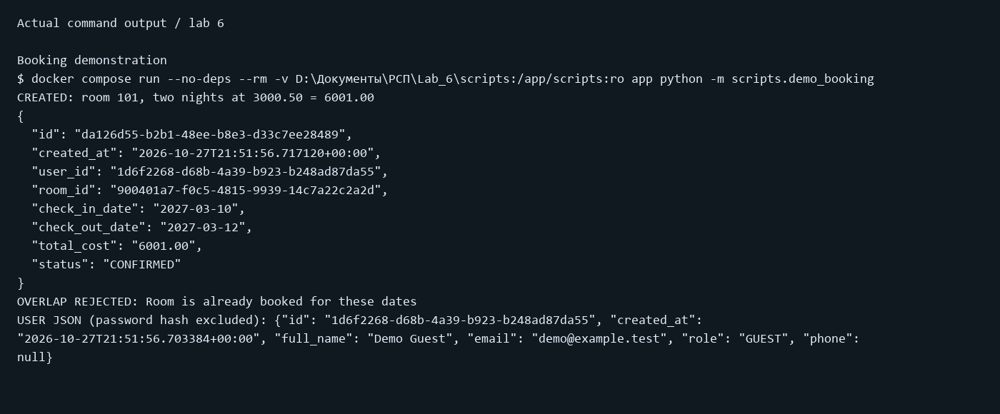

# Отчёт по лабораторной работе №6

Дисциплина: «Разработка серверных приложений»

Тема работы: Слой доступа к данным: Repository

Предметная область: бронирование номеров в городских отелях.

Выполнил: ____________________  Группа: __________

Проверил: ____________________  Учебное заведение: ____________________

Дата выполнения: 28.10.2026

## Цель

Отделить доступ к данным от бизнес-логики, реализовать безопасные CRUD-операции, преобразование ошибок и интеграционные тесты.

## Реализация

### internal/repository/interfaces.py

```python
"""Contracts only. This module does not import psycopg or PostgreSQL code."""
from contextlib import AbstractContextManager
from datetime import date
from typing import Protocol, TypeVar
from uuid import UUID
from internal.domain.models import User, Hotel, Room, Booking

T = TypeVar("T")


class Repository(Protocol[T]):
    def create(self, entity: T) -> T: ...
    def get_by_id(self, entity_id: UUID | str) -> T: ...
    def list(self, limit: int = 20, offset: int = 0) -> list[T]: ...
    def delete(self, entity_id: UUID | str) -> None: ...


class UserRepository(Repository[User], Protocol):
    def get_by_email(self, email: str) -> User: ...


class HotelRepository(Repository[Hotel], Protocol):
    pass


class RoomRepository(Repository[Room], Protocol):
    def update(self, room: Room) -> Room: ...
    def get_for_update(self, room_id: UUID | str) -> Room: ...


class BookingRepository(Repository[Booking], Protocol):
    def has_overlap(self, room_id: UUID | str, start: date, end: date) -> bool: ...


class Repositories(Protocol):
    users: UserRepository
    hotels: HotelRepository
    rooms: RoomRepository
    bookings: BookingRepository


class UnitOfWork(Protocol):
    def transaction(self) -> AbstractContextManager[Repositories]: ...

```

### internal/repository/postgres/base.py

```python
from typing import Generic, TypeVar
from psycopg.rows import dict_row
from internal.domain.errors import ErrNotFound, ErrInvalidInput
from internal.repository.postgres.db import mapped_errors

T = TypeVar("T")


def pagination(limit, offset):
    if type(limit) is not int or type(offset) is not int:
        raise ErrInvalidInput("limit and offset must be integers")
    if limit <= 0 or offset < 0:
        raise ErrInvalidInput("limit must be positive; offset must be nonnegative")
    return min(limit, 100), offset


class PostgresRepository(Generic[T]):
    """Subclasses contain fixed, explicit SQL; no user input forms SQL text."""
    model = None
    insert_fields = ()
    insert_sql = select_sql = list_sql = delete_sql = ""

    def __init__(self, source):
        self.source = source

    def _one(self, query, params) -> T:
        with mapped_errors():
            with self.source.connection() as conn:
                with conn.cursor(row_factory=dict_row) as cur:
                    cur.execute(query, params)
                    row = cur.fetchone()
                    if row is None:
                        raise ErrNotFound("Record not found")
                    return self.model(**row)

    def create(self, entity: T) -> T:
        return self._one(self.insert_sql, tuple(getattr(entity, f) for f in self.insert_fields))

    def get_by_id(self, entity_id) -> T:
        return self._one(self.select_sql, (entity_id,))

    def list(self, limit=20, offset=0) -> list[T]:
        limit, offset = pagination(limit, offset)
        with mapped_errors():
            with self.source.connection() as conn:
                with conn.cursor(row_factory=dict_row) as cur:
                    cur.execute(self.list_sql, (limit, offset))
                    return [self.model(**row) for row in cur.fetchall()]

    def delete(self, entity_id) -> None:
        with mapped_errors():
            with self.source.connection() as conn:
                with conn.cursor() as cur:
                    cur.execute(self.delete_sql, (entity_id,))
                    if cur.rowcount == 0:
                        raise ErrNotFound("Record not found")

```

### internal/repository/postgres/room.py

```python
from internal.domain.models import Room
from internal.repository.postgres.base import PostgresRepository


class PostgresRoomRepository(PostgresRepository[Room]):
    model = Room
    insert_fields = ("hotel_id", "room_number", "category", "price_per_night", "status", "capacity",)
    insert_sql = """INSERT INTO rooms (hotel_id, room_number, category, price_per_night, status, capacity)
        VALUES (%s, %s, %s, %s, %s, %s)
        RETURNING id, hotel_id, room_number, category, price_per_night, status, capacity, created_at"""
    select_sql = """SELECT id, hotel_id, room_number, category, price_per_night, status, capacity, created_at
        FROM rooms WHERE id = %s"""
    list_sql = """SELECT id, hotel_id, room_number, category, price_per_night, status, capacity, created_at
        FROM rooms ORDER BY created_at DESC, id LIMIT %s OFFSET %s"""
    delete_sql = "DELETE FROM rooms WHERE id = %s"

    def update(self, room):
        from psycopg.rows import dict_row
        from internal.domain.errors import ErrNotFound
        from internal.repository.postgres.db import mapped_errors
        with mapped_errors():
            with self.source.connection() as conn:
                with conn.cursor(row_factory=dict_row) as cur:
                    cur.execute("""UPDATE rooms SET hotel_id=%s, room_number=%s, category=%s,
                        price_per_night=%s, status=%s, capacity=%s WHERE id=%s
                        RETURNING id, hotel_id, room_number, category, price_per_night, status, capacity, created_at""",
                        tuple(getattr(room, f) for f in self.insert_fields) + (room.id,))
                    if cur.rowcount == 0:
                        raise ErrNotFound("Room not found")
                    return Room(**cur.fetchone())

    def get_for_update(self, room_id):
        # Only meaningful when the repository is bound to a Unit of Work transaction.
        return self._one("""SELECT id, hotel_id, room_number, category, price_per_night, status, capacity, created_at
            FROM rooms WHERE id = %s FOR UPDATE""", (room_id,))

```

## Соответствие ошибок

| Ситуация | SQLSTATE/признак | Доменная ошибка | HTTP |
|---|---|---|---|
| Нет пользователя/номера/брони | None или rowcount=0 | ErrNotFound | 404 |
| Повтор email или номера внутри отеля | 23505 | ErrAlreadyExists | 409 |
| Нет родителя; удаление номера с бронями | 23503 | ErrConflict | 409 |
| CHECK, NULL, неверный UUID | 23514, 23502, 22P02 | ErrInvalidInput | 400 |
| Сбой сети/таймаут | Другая ошибка драйвера | RepositoryError с __cause__ | 500 |
| Пересечение бронирований | Проверка в сервисе | ErrConflict | 409 |

## Результаты проверки

Ниже визуальные копии сохранённого вывода реально выполненных команд. Это рендер журнала, а не снимки окна терминала. Полный вывод и коды завершения приведены далее и сохранены в JSON.




### Полный журнал

#### Create isolated test database

```text
$ docker compose exec -T db psql -U hotel_app -d hotels -v ON_ERROR_STOP=1 -c "CREATE DATABASE lab6_test_ea8f7f69ecab;"
CREATE DATABASE
Exit code: 0
```

#### Apply test migration

```text
$ docker compose run --no-deps --rm migrate up
1/u init_schema (73.525603ms)
Exit code: 0
```

#### Integration tests

```text
$ docker compose run --no-deps --rm -v D:\Документы\РСП\Lab_6\tests:/app/tests:ro app python -m unittest discover -s tests -v
test_adjacent_dates_and_canceled_booking (test_repositories.RepositoryIntegrationTests.test_adjacent_dates_and_canceled_booking) ... ok
test_check_null_and_invalid_uuid_mapping (test_repositories.RepositoryIntegrationTests.test_check_null_and_invalid_uuid_mapping) ... ok
test_concurrent_overlapping_bookings_only_one_succeeds (test_repositories.RepositoryIntegrationTests.test_concurrent_overlapping_bookings_only_one_succeeds) ... ok
test_create_and_read_all_four_entities (test_repositories.RepositoryIntegrationTests.test_create_and_read_all_four_entities) ... ok
test_database_generates_identity_and_timestamp (test_repositories.RepositoryIntegrationTests.test_database_generates_identity_and_timestamp) ... ok
test_decimal_exactness_and_private_json (test_repositories.RepositoryIntegrationTests.test_decimal_exactness_and_private_json) ... ok
test_delete_and_subsequent_read_for_all_entities (test_repositories.RepositoryIntegrationTests.test_delete_and_subsequent_read_for_all_entities) ... ok
test_duplicate_email_and_room_number (test_repositories.RepositoryIntegrationTests.test_duplicate_email_and_room_number) ... ok
test_foreign_key_errors_and_delete_restrict (test_repositories.RepositoryIntegrationTests.test_foreign_key_errors_and_delete_restrict) ... ok
test_http_demo_maps_data_and_domain_errors (test_repositories.RepositoryIntegrationTests.test_http_demo_maps_data_and_domain_errors) ... ok
test_invalid_dates_and_unavailable_room (test_repositories.RepositoryIntegrationTests.test_invalid_dates_and_unavailable_room) ... ok
test_missing_read_for_all_repositories (test_repositories.RepositoryIntegrationTests.test_missing_read_for_all_repositories) ... ok
test_pagination_for_all_repositories (test_repositories.RepositoryIntegrationTests.test_pagination_for_all_repositories) ... ok
test_pagination_upper_limit_and_invalid_arguments (test_repositories.RepositoryIntegrationTests.test_pagination_upper_limit_and_invalid_arguments) ... ok
test_room_update_and_missing_update (test_repositories.RepositoryIntegrationTests.test_room_update_and_missing_update) ... ok
test_sql_injection_is_literal_email (test_repositories.RepositoryIntegrationTests.test_sql_injection_is_literal_email) ... ok
test_transaction_commit_and_overlap_rejected (test_repositories.RepositoryIntegrationTests.test_transaction_commit_and_overlap_rejected) ... ok
test_transaction_rolls_back_all_changes (test_repositories.RepositoryIntegrationTests.test_transaction_rolls_back_all_changes) ... ok
test_unexpected_db_error_preserves_cause (test_repositories.RepositoryIntegrationTests.test_unexpected_db_error_preserves_cause) ... ok

----------------------------------------------------------------------
Ran 19 tests in 1.871s

OK
Exit code: 0
```

#### Booking demonstration

```text
$ docker compose run --no-deps --rm -v D:\Документы\РСП\Lab_6\scripts:/app/scripts:ro app python -m scripts.demo_booking
CREATED: room 101, two nights at 3000.50 = 6001.00
{
  "id": "da126d55-b2b1-48ee-b8e3-d33c7ee28489",
  "created_at": "2026-10-27T21:51:56.717120+00:00",
  "user_id": "1d6f2268-d68b-4a39-b923-b248ad87da55",
  "room_id": "900401a7-f0c5-4815-9939-14c7a22c2a2d",
  "check_in_date": "2027-03-10",
  "check_out_date": "2027-03-12",
  "total_cost": "6001.00",
  "status": "CONFIRMED"
}
OVERLAP REJECTED: Room is already booked for these dates
USER JSON (password hash excluded): {"id": "1d6f2268-d68b-4a39-b923-b248ad87da55", "created_at": "2026-10-27T21:51:56.703384+00:00", "full_name": "Demo Guest", "email": "demo@example.test", "role": "GUEST", "phone": null}
Exit code: 0
```

#### Final service status

```text
$ docker compose ps -a
NAME              IMAGE                     COMMAND                  SERVICE   CREATED          STATUS                      PORTS
lab_6-app-1       lab_6-app                 "python -m cmd.app.m…"   app       59 seconds ago   Up 52 seconds (healthy)     127.0.0.1:8086->8080/tcp
lab_6-db-1        postgres:16-alpine        "docker-entrypoint.s…"   db        59 seconds ago   Up 59 seconds (healthy)     127.0.0.1:5436->5432/tcp
lab_6-migrate-1   migrate/migrate:v4.18.1   "migrate -path=/migr…"   migrate   59 seconds ago   Exited (0) 52 seconds ago
Exit code: 0
```

#### Remove only the temporary test database

```text
$ docker compose exec -T db psql -U hotel_app -d hotels -v ON_ERROR_STOP=1 -c "DROP DATABASE lab6_test_ea8f7f69ecab;"
DROP DATABASE
Exit code: 0
```

## Ответы на контрольные вопросы


1. **Что такое Repository?** Отдельный слой работы с хранилищем. SQL сосредоточен
   в одном месте, а HTTP-обработчик занимается запросом и ответом, не таблицами.
2. **Что такое SQL-инъекция и защита?** Ввод пользователя превращается в SQL-команду
   при склейке строк. Параметры передают ввод как данные. Имена таблиц/столбцов и
   направление сортировки выбирают из белого списка.
3. **Зачем доменные ошибки и кто выбирает HTTP-код?** Они избавляют сервис от
   зависимости от драйвера. Репозиторий переводит ошибку базы в доменную;
   HTTP-обработчик переводит доменную в 400/404/409/500.
4. **SQL, Query Builder, ORM?** SQL пишется вручную: полный контроль, больше кода.
   Query Builder собирает SQL из вызовов: удобнее динамические фильтры.
   ORM связывает объекты с таблицами: быстрее CRUD, но запросы и их стоимость
   могут быть неочевидными.
5. **Транзакция, ACID и передача?** Несколько действий как одна операция:
   атомарность, согласованность, изолированность, долговечность.
   В нашем Unit of Work все репозитории используют одно соединение и одну транзакцию.
6. **Зачем уникальный ORDER BY и чем плох OFFSET?** Он задаёт однозначный порядок
   строк, включая одинаковое время создания. Большой OFFSET заставляет базу
   читать и пропускать много строк; keyset-пагинация работает по последнему ключу.
7. **Как интерфейс помогает тестированию?** Сервису передают fake/mock с теми же
   методами, и проверяют бизнес-правила без базы. Интеграционные тесты реального
   репозитория всё равно нужны для проверки SQL и ограничений.


## Выводы

Реализованы четыре репозитория с независимыми интерфейсами, безопасным SQL и доменными ошибками. Проверки работают на отдельной PostgreSQL-базе. Транзакция с блокировкой номера отклоняет пересекающиеся брони, включая конкурентные запросы.
